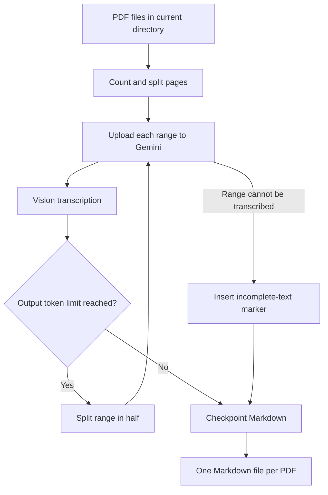

# ContextScribe

**Turn visual PDFs into faithful, LLM-ready Markdown with Gemini vision.**

ContextScribe transcribes scanned, image-heavy, and visually complex PDF documents into structured Markdown. The resulting files are easier to search, version, inspect, and provide as context to Claude, Gemini, GPT, local models, and text-only AI systems.

Instead of asking every downstream model to interpret the original PDF again, ContextScribe performs the visual work once and produces reusable textual context.

## Why ContextScribe?

PDFs are convenient for people, but inefficient as recurring LLM context:

- scanned pages require OCR or vision;
- tables, stamps, signatures, and page structure need visual interpretation;
- text-only models cannot read image-based PDFs;
- repeatedly attaching PDFs consumes time, tokens, and multimodal capacity;
- important text can compete with reasoning for the model's context window.

Markdown preserves the useful document content in a compact, portable format. This can substantially reduce context usage compared with repeatedly processing page images, although the exact savings depend on the PDF and the downstream model.

ContextScribe is particularly useful for legal records, archives, contracts, filings, reports, and other documents where faithful transcription matters more than summarization.

## Features

- **Vision-based transcription** through the Google Gemini API.
- **Image and scan support**, not just embedded PDF text extraction.
- **Faithful output** that preserves original wording, spelling, numbers, tables, stamps, signatures, and visible annotations when possible.
- **Structured Markdown** with physical page markers such as `<!-- Página 12 -->`.
- **Batch processing** of every PDF in the current directory.
- **Parallel workers** for processing multiple documents concurrently.
- **Unicode filename support**, including accents and `ñ` on Windows.
- **Long-document chunking**, with configurable initial page ranges.
- **Adaptive splitting** when a response reaches Gemini's output-token limit.
- **Partial-result recovery**: successful chunks are checkpointed even when a later range fails.
- **Explicit omission markers** for ranges that could not be transcribed:

  ```text
  TEXTO INCOMPLETO, NO SE INCLUYEN LAS PÁGINAS 31 A LA 52
  ```

- **Remote cleanup**: uploaded temporary files are deleted from Gemini after each request.

## How it works



By default, documents are split into ranges of up to 30 pages. If Gemini reports that a range exhausted its output budget, ContextScribe recursively divides only that range and tries smaller pieces.

## Requirements

- Python 3.14 or newer
- [`uv`](https://docs.astral.sh/uv/)
- A [Google AI Studio API key](https://aistudio.google.com/apikey)
- Internet access for Gemini API requests

## Installation

From the project directory:

```bash
uv sync
```

Create your local environment file:

### PowerShell

```powershell
Copy-Item .env.example .env
```

### macOS or Linux

```bash
cp .env.example .env
```

Then place your Gemini API key in `.env`:

```dotenv
GEMINI_API_KEY=your-api-key
```

The `.env` file is ignored by Git. Never commit your API key.

## Usage

1. Place the PDFs you want to transcribe directly in the project directory.
2. Run:

   ```bash
   uv run python main.py
   ```

   On Windows, this also works:

   ```powershell
   uv run .\main.py
   ```

3. Find the generated files in:

   ```text
   markdown/
   ```

For example:

```text
report.pdf  ->  markdown/report.md
```

Only PDFs located directly in the current directory are processed. Subdirectories are not scanned.

## Configuration

ContextScribe reads `.env` from the directory containing `main.py`.

| Variable | Default | Description |
| --- | ---: | --- |
| `GEMINI_API_KEY` | — | Google Gemini API key. Required unless `GOOGLE_API_KEY` is set. |
| `GOOGLE_API_KEY` | — | Alternative API-key variable supported by the client. |
| `GEMINI_MODEL` | `gemini-3.5-flash-lite` | Gemini model used for transcription. |
| `GEMINI_MAX_WORKERS` | `15` | Concurrent PDF workers. Capped at 15. |
| `GEMINI_MAX_RETRIES` | `4` | Attempts for errors classified as transient. |
| `GEMINI_MAX_PAGES_PER_CHUNK` | `30` | Maximum size of each initial page range. |

Example:

```dotenv
GEMINI_API_KEY=your-api-key
GEMINI_MODEL=gemini-3.5-flash-lite
GEMINI_MAX_WORKERS=5
GEMINI_MAX_RETRIES=4
GEMINI_MAX_PAGES_PER_CHUNK=30
```

Lower `GEMINI_MAX_WORKERS` if you encounter API rate limits. Lower `GEMINI_MAX_PAGES_PER_CHUNK` for unusually dense documents or when smaller requests are preferable.

## Long and incomplete documents

Gemini's configured maximum output is 65,536 tokens. ContextScribe protects against silently saving token-truncated responses:

1. It starts with page ranges controlled by `GEMINI_MAX_PAGES_PER_CHUNK`.
2. If Gemini returns a token-limit finish reason, the affected range is divided recursively.
3. Completed initial ranges are written to disk immediately as checkpoints.
4. If a range fails for another reason, the rest of the document continues and the missing pages are clearly identified in the Markdown.

An incomplete document is saved but reported separately, and the process exits with status code `1` so automation can detect that manual review is required.

## Known limitations

- Transcription quality depends on scan quality, handwriting legibility, layout complexity, and the selected Gemini model.
- AI transcription can contain errors. Verify generated Markdown before relying on it for legal, medical, financial, or other high-stakes work.
- Gemini may return `RECITATION` for content affected by its copyright safeguards. ContextScribe cannot disable that safeguard; it preserves the other successful ranges and marks the omission.
- A single extremely dense page can still exceed the model's output limit.
- The current transcription prompt is deliberately strict and optimized for high-fidelity documentary and legal transcription rather than summarization.
- Processing consumes Gemini API quota and may incur charges under your Google account.

## Privacy

PDF contents are uploaded to Google's Gemini API for processing. ContextScribe deletes each uploaded remote file after its request completes, but API processing remains subject to Google's terms, retention policies, and the settings of your account or project.

Do not process confidential, privileged, personal, or regulated documents unless your use of Gemini complies with the applicable legal, contractual, and organizational requirements.

## Development

Compile-check the main script:

```bash
uv run python -m py_compile main.py
```

The implementation is currently a focused single-file application in `main.py`. Contributions that preserve transcription fidelity, explicit failure reporting, and safe partial output are welcome.

## Project status

ContextScribe is an early-stage project. Interfaces, defaults, and output conventions may change before a stable release.

## License

A license has not been selected yet. Add an OSI-approved license before distributing the project as open source; MIT or Apache-2.0 are good defaults depending on the desired patent terms.
